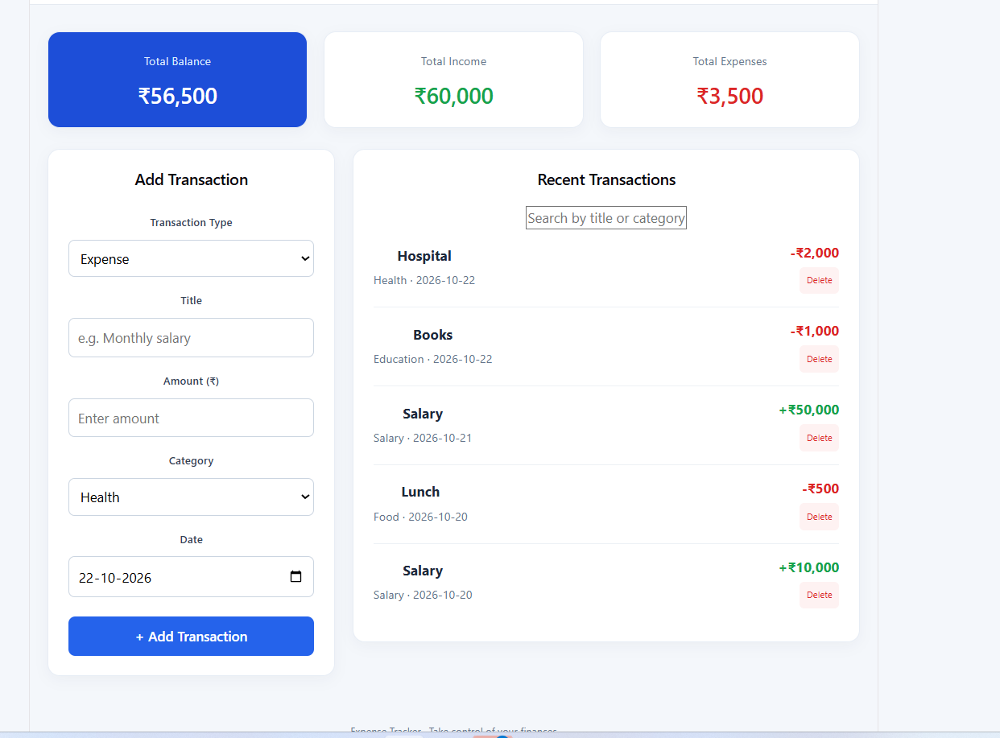
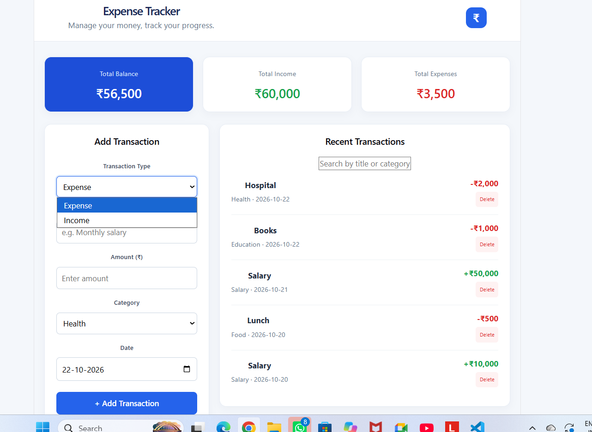
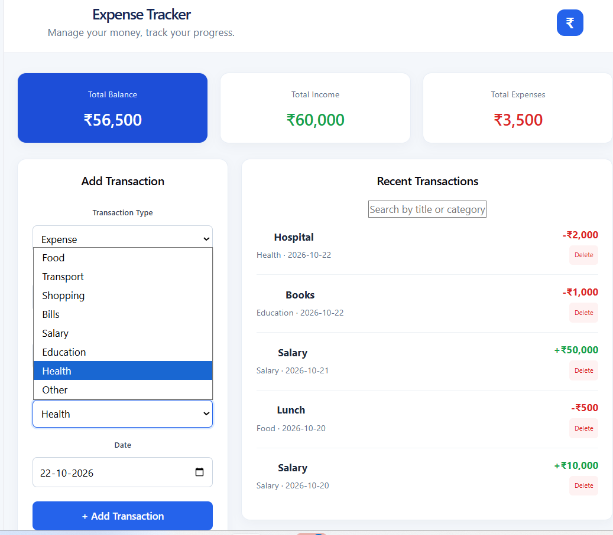

# Expense Tracker

A full-stack web application for tracking income and expenses, managing transactions, and monitoring your financial balance.

## Features

- Add income and expense transactions
- Categorize transactions
- Record transaction dates
- View total income, total expenses, and balance
- View recent transactions
- Search transactions by title or category
- Delete transactions
- Update existing transactions through the backend API

## Technologies Used

**Frontend**
- React
- Vite
- CSS

**Backend**
- Python
- FastAPI
- SQLite

## Project Structure

```text
ExpenseTracker/
├── frontend/
│   ├── src/
│   │   ├── App.jsx
│   │   └── App.css
│   └── package.json
├── backend/
│   ├── main.py
│   └── requirements.txt
├── .gitignore
└── README.md
```

## Prerequisites

- Python 3.11 or later
- Node.js and npm
- Git

## Installation and Setup

### 1. Clone the repository

```bash
git clone YOUR_GITHUB_REPOSITORY_URL
cd ExpenseTracker
```

Replace `YOUR_GITHUB_REPOSITORY_URL` with your repository URL after creating it.

### 2. Set up the backend

Open a terminal in the project folder:

```bash
cd backend
python -m venv venv
```

Activate the virtual environment on Windows:

```powershell
.\venv\Scripts\Activate.ps1
```

Install the dependencies:

```bash
pip install -r requirements.txt
```

Start the backend:

```bash
uvicorn main:app --reload
```

Backend URL: http://127.0.0.1:8000

API documentation: http://127.0.0.1:8000/docs

### 3. Set up the frontend

Open a second terminal:

```bash
cd frontend
npm install
npm run dev
```

Open the local URL printed in the terminal, usually http://localhost:5173.

## Database

The application uses SQLite to store transactions. The database file is created locally by the backend when the application starts.

## Future Improvements

- Complete transaction editing in the frontend
- Add charts and expense reports
- Add monthly filtering
- Add user authentication

## Author

Developed as a full-stack development internship project.
 


## Screenshots

### Dashboard


### Transaction Type


### Category



## Demo Video

Watch the ExpenseTracker application demo:

[▶️ Watch ExpenseTracker Demo](https://drive.google.com/file/d/1N4z6lXcGWCbhkEBqvPX5JOaBl5BUB_wo/view?usp=sharing)
